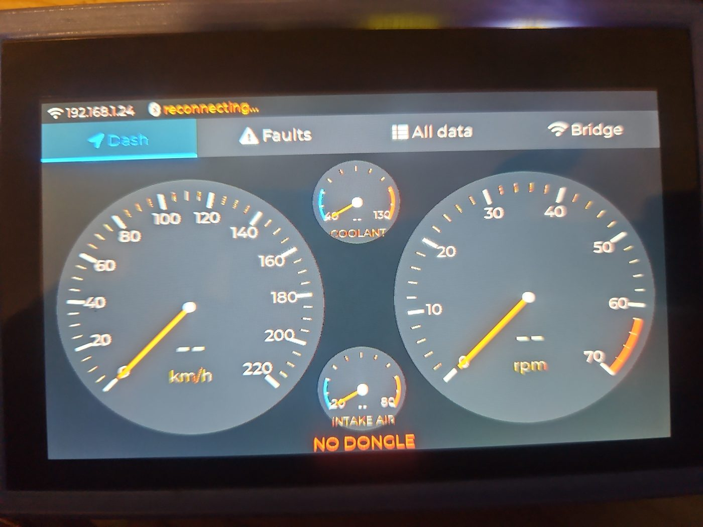

# cyd-vehicle-dash

A touchscreen car dashboard and OBD2 diagnostics bridge built on an ESP32 and a cheap Bluetooth ELM327 dongle.

It started as a way to find out what a no-name OBD2 dongle actually does and what a 2005 Holden/Opel Astra will report, and turned into a stand-in for a broken instrument cluster: speedometer, tachometer, coolant and intake temperatures, battery voltage and fault codes on a 4.3" touchscreen, with a WiFi web page and a raw ELM327 TCP bridge so phones, laptops and apps can still reach the car.



*The Dash screen, waiting for the dongle: speedometer, tachometer, coolant and intake-air gauges in the centre, and the battery voltage / connection status at the bottom.*

> **Not a certified instrument cluster.** It only shows what the engine ECU reports over OBD2. It cannot show turn signals, high beam, oil pressure, brake, ABS, airbag or fuel level, and on slow K-line cars speed updates about twice a second. Use it alongside the car's own warning lamps.

## Features

**Touchscreen** (Waveshare ESP32-S3-Touch-LCD-4.3), with a tab bar across the top:

| Screen | What it shows |
|---|---|
| **Dash** | Speedometer 0–220 km/h and tachometer 0–7,000 rpm with needles and large digits; small blue-to-red gauges for coolant and intake-air temperature; battery voltage; check-engine warning; a clear *NO DONGLE* / *NO DATA* banner when readings stop. |
| **Faults** | Check-engine status, stored and pending codes with short descriptions, plus (on K-line ECUs) the ECU's own fault memory, which also lists faults other modules have reported, such as an automatic gearbox. *Clear codes* asks for confirmation first. |
| **All data** | Every PID the ECU supports, decoded and updating continuously. |
| **Bridge** | WiFi mode (off / home WiFi with hotspot fallback / hotspot only), TCP bridge on/off, addresses and passwords for connecting, dongle scan / reconnect / forget, screen rotation, restart. |

**Over WiFi** (all boards):

- **Web page** on port 80: Bluetooth scan and connect, the dongle's full GATT layout, raw command terminal, adapter fingerprint (which ELM327 commands a clone really supports), a full vehicle probe (protocol, ECUs, supported PIDs, VIN, calibration, fault codes), live data, a timestamped TX/RX log, and firmware upload.
- **Raw TCP bridge on port 35000**, the same as a WiFi ELM327, for Torque, python-OBD or `telnet`.
- **JSON API** for scripting (see below).
- **Over-the-air updates**: from the web page, with `curl`, or via ArduinoOTA.

**Behaviour**:
- Remembers the dongle and reconnects automatically. It listens for the dongle's Bluetooth advertisements first (a 3 s scan every ~10 s) and only connects when it's there, so a parked car doesn't tie up the radio.
- Starts straight to the dash; WiFi comes up in the background.
- **Screen sleep:** with no dongle connected and no touch for 1 minute, the backlight turns off and drawing stops. A touch wakes it (that touch doesn't press anything), and so does the dongle connecting. The chip stays awake meanwhile: deep sleep would switch off the radio that listens for the dongle.
- Records the reason for every restart, plus a crash backtrace in flash.

## Hardware

| Board | Bluetooth | Screen | Status |
|---|---|---|---|
| **Waveshare ESP32-S3-Touch-LCD-4.3** (800×480 RGB, GT911 touch, 8 MB PSRAM, 8 MB flash) | BLE | yes | Main target, in use |
| Original ESP32 (ESP-WROOM-32 / D0WD) | Classic SPP **or** BLE (one per boot) | no | Works, but see *Classic Bluetooth on the original ESP32* |
| ESP32-C3 | BLE | no | Works |

ESP32-S2, S3, C3, C6 and H2 chips have **no Classic Bluetooth**. Many cheap OBD2 dongles are Classic SPP-only; some (like the one this was built with) are dual-mode and also expose a BLE serial service.

**Dongle used:** generic "OBDII" ELM327 v1.5 clone with a JieLi dual-mode chip.
- **BLE:** service `FFF0`, notify `FFF1`, write `FFF2`.
- **Classic:** SPP on RFCOMM channel 2 (not the usual 1), PIN 1234.

The firmware recognises the common BLE layouts (`FFF0`, `FFE0`, `18F0`, OBDLink/STN, Nordic UART) and otherwise picks the first notify/write pair it finds.

**Car tested:** 2005 Holden/Opel Astra H, Z18XE 1.8 L, Siemens engine ECU, ISO 14230-4 (KWP2000 fast init, K-line), automatic.

## Building

You need [arduino-cli](https://arduino.github.io/arduino-cli/), the Espressif ESP32 core 3.3.x (tested with 3.3.12) and LVGL 8.4.0:

```bash
arduino-cli config add board_manager.additional_urls https://espressif.github.io/arduino-esp32/package_esp32_index.json
arduino-cli core update-index && arduino-cli core install esp32:esp32
arduino-cli lib install "lvgl@8.4.0"
```

Then:

```bash
cd obd_probe
cp secrets.example.h secrets.h   # your home WiFi + hotspot password (git-ignored)
./build.sh s3                    # or: esp32, c3
```

`build.sh` puts the images in `build-<board>/` and keeps a copy of each version's `.elf` in `elf/`. Hold on to the `.elf` for anything you flash: crash backtraces only decode against the exact build.

### First flash (USB)

On the Waveshare board, use the USB-C port marked **UART** (the CH343 serial chip). The native USB port drops out whenever the chip resets.

```bash
esptool --chip esp32s3 --port /dev/ttyACM0 --baud 921600 write-flash 0x0 build-s3/obd_probe.ino.merged.bin
```

The merged image erases saved settings. To keep them, write just the app at `0x10000` and erase `otadata` (`0xe000`, size `0x2000`) so the board boots it.

### Updates over WiFi

```bash
curl http://<ip>/api/prepare-update                       # stops Bluetooth to free memory for the upload
curl -F fw=@build-s3/obd_probe.ino.bin http://<ip>/update # verifies, then reboots into the new image
```

The web page's *Firmware update* box does both steps. A failed or interrupted upload reboots back into the old firmware. After an update, the S3 reports its restart as *other watchdog*; that's a quirk of restarting with the RGB panel running, and the new image boots normally.

## Using it

1. Power the board from a USB socket in the car and plug in the dongle. Make sure no phone is connected to the dongle.
2. **First time only:** on **Bridge → Scan**, tap the dongle (✓ marks likely OBD adapters). After that it reconnects by itself, retrying at least every 30 s.
3. With the ignition on, the dash comes alive once the ECU answers. On first connect it finds the supported PIDs and checks whether the adapter supports the faster "one reply expected" mode.

**WiFi**:
- **Home** mode joins your network and adds the hotspot if it isn't found within 20 s.
- **Hotspot only** always runs the `AP_SSID` network from `secrets.h`; the board is at `192.168.4.1`.
- **Off** disables the web page and bridge until switched back on from the screen.

## JSON API

All endpoints are `GET` unless noted, and return JSON.

| Endpoint | Purpose |
|---|---|
| `/api/status` | Firmware, chip, memory, WiFi, dongle link and layout, bridge client, last restart reason, recent HTTP clients |
| `/api/scan?type=ble\|spp&secs=N` | Bluetooth scan (`spp` only on the original ESP32) |
| `/api/connect?type=ble&addr=..&atype=0` | Connect and save; BLE also accepts `rx=`/`tx=` UUIDs; `spp` accepts `pin=` |
| `/api/disconnect`, `/api/reconnect`, `/api/forget` | Link control |
| `/api/auto?on=0\|1` | Auto-reconnect on/off |
| `/api/cmd?c=010C&t=5000` | Send one ELM327/OBD command, wait for the `>` prompt; returns raw reply and timing |
| `/api/gatt` | GATT table from the last BLE connect |
| `/api/log?since=N` | Timestamped TX/RX/info log |
| `/api/crash` | Last crash summary (task, PC, backtrace); `?erase=1` clears it |
| `/api/prepare-update`, `POST /update` | Over-the-air update (see above) |
| `/api/reboot` | Restart |

Decode a crash backtrace with:

```bash
xtensa-esp32s3-elf-addr2line -pfiaC -e elf/obd_probe-<ver>-s3.elf <pc> <bt...>
```

## What the Astra reports

**Supported mode-01 PIDs:**

| PID | Reading |
|---|---|
| 01 | Monitor status |
| 02 | Freeze-frame code |
| 03 | Fuel system status |
| 04 | Engine load |
| 05 | Coolant temperature |
| 06, 07 | Short- and long-term fuel trim |
| 0C | RPM |
| 0D | Speed |
| 0E | Timing advance |
| 0F | Intake air temperature |
| 10 | MAF air flow |
| 11 | Throttle position |
| 13 | O2 sensors present |
| 14, 15 | O2 sensor voltages |
| 1C | OBD standard (EOBD) |
| 21 | Distance with check-engine light on |

**Other modes:**
- Freeze frame (mode 02), monitor tests (mode 06, test IDs 01/02/06) and vehicle info (mode 09) work.
- Modes 05 and 0A, and PID 41, are not supported.

**KWP2000 services that also work:**
- `1A xx`: ECU identification. Supplier, engine code, software and calibration numbers.
- `18 00 FF 00`: fault memory by status. This showed a gearbox fault (`P0700`) that standard mode 03 did not.

## Lessons learned

- **Classic Bluetooth on the original ESP32:** the precompiled Arduino core enables Classic, BLE, A2DP and HFP with 8 KB task stacks. With Classic SPP and WiFi up, only about 10–18 KB of heap is left, so WiFi stalls while reconnecting. That's why only one Bluetooth stack runs per boot, and updates stop Bluetooth first. PSRAM does **not** help here: this core allocates WiFi and Bluetooth from internal RAM only. Fixing it properly needs a custom `sdkconfig` build, or an HC-05 module on a UART.
- **NimBLE** (S3/C3) ignores the connect-timeout argument; a failed BLE connect always takes about 30 s.
- **ELM327 clones** cut off long KWP replies at about 84 bytes, and some answer `OK` to every AT command, including ones they don't implement.
- **K-line throughput:** roughly 4 requests a second, about 250 ms each.

## Licence

[GNU Affero General Public License v3.0](LICENSE).
